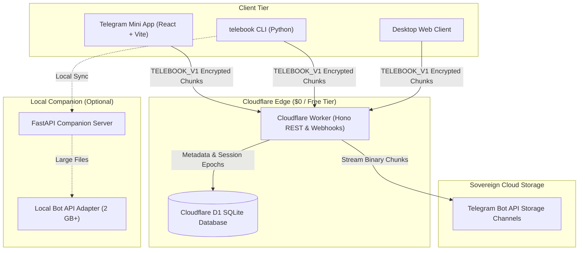

# TeleBook

[](https://github.com/ShoumikBalaSomu/IPYNB-Hosting-TG/actions)
[](LICENSE)
[](#free-tier-architecture)
[](https://core.telegram.org/bots/api)

TeleBook is an open-source, zero-knowledge private Jupyter Notebook (`.ipynb`) hosting, rendering, and in-browser execution platform. It runs on a strictly serverless, zero-cost topology leveraging Cloudflare Workers, Cloudflare D1, and encrypted Telegram Bot storage.

---

## Key Highlights

- **Zero-Knowledge Privacy (`TELEBOOK_V1`)**: Plaintext notebook contents never touch Cloudflare or Telegram servers unencrypted. Notebook data is compressed with Gzip and encrypted client-side using AES-256-GCM with a 96-bit CSPRNG IV and AAD bound to the notebook ID, version, and chunk index.
- **Telegram Storage Engine with 15 MB Chunking**: Files are partitioned into 15 MB chunks to operate comfortably below Telegram's 20 MB `getFile` download threshold. Chunks are cryptographically verified with SHA-256 digests upon reassembly.
- **Strict Single-Owner Model**: Designed as a sovereign personal workspace locked to a single administrator identified by `OWNER_TELEGRAM_ID`. Unauthorized requests are rejected immediately without leaking notebook existence or system metadata.
- **Dual-Mode Web Application**: Operates seamlessly as a Telegram Mini App (TMA) inside mobile and desktop Telegram clients, or as a standalone desktop web application with theme synchronization and keyboard navigation.
- **Isolated Execution & Rendering**: Python syntax highlighting, KaTeX mathematics, ANSI tracebacks, and sanitized HTML. Rich interactive charts run inside opaque sandboxed iframes (`sandbox="allow-scripts"` without `allow-same-origin`).
- **In-Browser Execution via Pyodide**: Re-execute Python code cells directly in your browser using an isolated WebAssembly Web Worker, and save modified notebooks back to sovereign storage as immutable new versions.
- **Command-Line Interface & Companion Daemon**: A standalone Python CLI (`telebook`) and self-hosted FastAPI companion server supporting offline storage and local folder synchronization.

---

## Architecture Overview



---

## Quickstart (Under 3 Minutes)

### 1. Cloudflare Workers + Telegram Setup

1. **Clone the repository**:
   ```bash
   git clone https://github.com/ShoumikBalaSomu/IPYNB-Hosting-TG.git
   cd IPYNB-Hosting-TG
   npm install
   ```

2. **Configure environment variables**:
   Create a bot via `@BotFather` on Telegram and obtain your bot token. Find your numeric Telegram ID via `@userinfobot`.
   ```bash
   cp apps/worker/.dev.vars.example apps/worker/.dev.vars
   ```
   Configure the following in `apps/worker/.dev.vars`:
   - `TELEGRAM_BOT_TOKEN`: Your Telegram Bot API token.
   - `OWNER_TELEGRAM_ID`: Your numeric Telegram user ID.
   - `TELEGRAM_WEBHOOK_SECRET`: A secure random hex string for webhook validation.
   - `JWT_SECRET`: A secure random secret for web sessions.

3. **Initialize Cloudflare D1 database**:
   ```bash
   npx wrangler d1 create telebook-db
   npx wrangler d1 execute telebook-db --file=apps/worker/migrations/0001_initial.sql
   ```

4. **Deploy worker and web app**:
   ```bash
   npm run build
   npx wrangler deploy
   ```

### 2. Local Companion Setup with Docker

If you prefer self-hosting without Cloudflare:

```bash
cd apps/local-server
cp .env.example .env
docker compose up -d
```

The FastAPI companion server will be available at `http://localhost:8000`.

---

## CLI Usage

Install the command-line client:

```bash
pip install ./packages/cli
```

Authenticate with your instance using an ephemeral 120-second token from your Telegram bot:

```bash
telebook login
```

Push and pull encrypted notebooks:

```bash
# Push notebook to sovereign storage
telebook push analysis.ipynb

# Pull and decrypt notebook locally
telebook pull nb_01h8abc123 --output local_copy.ipynb

# Export all hosted notebooks cleanly (zero vendor lock-in)
telebook export-all ./backup_directory/
```

---

## Free-Tier Economics ($0 / Month)

| Platform Component | Free Tier Allowance | TeleBook Consumption | Projected Cost |
| :--- | :--- | :--- | :--- |
| **Cloudflare Workers** | 100,000 requests / day | ~1,000 requests / day | **$0.00** |
| **Cloudflare D1** | 5M read rows / 100k write rows / day | Indexed point lookups (<1k rows) | **$0.00** |
| **Telegram Bot API** | Unlimited document storage | Encrypted 15 MB chunks | **$0.00** |
| **Client WebAssembly** | Client CPU / Memory | Offloaded to browser | **$0.00** |

---

## Documentation

- [System Architecture](docs/ARCHITECTURE.md)
- [Security Model & Cryptography](docs/SECURITY_MODEL.md)
- [Self-Hosting Guide](docs/SELF_HOSTING.md)
- [CLI Reference Manual](docs/CLI_GUIDE.md)
- [Web & Mini App User Guide](docs/USER_GUIDE.md)
- [Security Audit Report](docs/05_SECURITY_AUDIT.md)

---

## License

TeleBook is distributed under the [MIT License](LICENSE).
